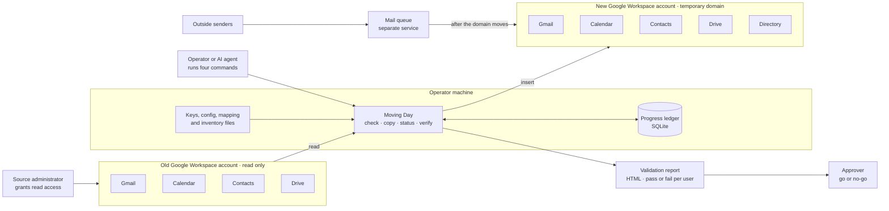

# Moving Day

Moving Day (`movingday`) is a command-line tool that copies mail, calendars,
contacts and Drive files from one Google Workspace account to another, so a domain can move between
accounts without a per-user migration licence and without a third party
handling stored mail.

It is built to be run by an AI agent, or by a person typing the same four
commands. People approve every irreversible step, and a per-user validation
report is the evidence for sign-off.

**Status:** built, with 291 logic tests passing against a simulated Google
API. It has not yet been run against real Google Workspace accounts. Work
through [docs/rehearsal-checklist.md](docs/rehearsal-checklist.md) before any
real copy.

## What it does

- Copies every in-scope message with its labels, read and starred state,
  dates and threads.
- Copies calendars: events, recurring series, attendees and sharing settings,
  without re-sending invitations.
- Copies each person's saved contacts with their labels. Contacts are never
  deleted on either side.
- Copies the files and folders each person owns in My Drive, with their
  folder structure and sharing (notifications off). Google Docs, Sheets and
  Slides go through Office format; uploaded files arrive byte for byte
  identical. Comments, suggestions and version history are not carried over.
- Scans every account before any copy (`check --source-only`): message
  counts, own, delegated and team calendars, contacts and Drive sizes, as
  counts only.
- Is safe to re-run. A second run copies only what is missing and creates no
  duplicates. An interrupted run resumes where it stopped.
- Builds on an earlier transfer made with another tool: with
  `--allow-existing`, earlier copies are matched by Message-ID, their labels
  brought up to date, and only the rest is copied.
- Reads the source account only. There is no delete command and no code path
  that changes the source.
- Keeps mail content out of its output, logs and reports. The operator sees
  user keys, counts and reason codes, never subjects, bodies, event titles,
  contact details, or file names and content.
- Writes an HTML validation report showing, for every user and every check,
  the condition, the expected result and the actual result.

## What it does not do

- Shared drives (files in My Drive are copied). Google Forms and other
  Google file types with no export are counted, not copied.
- "Other contacts" (addresses Gmail saves automatically); the scan and the
  report count them for information.
- Gmail settings: filters, signatures, forwarding and send-as.
- Spam, Trash, Chat history and unsent drafts.
- Creating users, groups and aliases. These are created by hand; the
  validation report checks they exist.
- DNS changes, releasing or claiming the domain, and mail routing.
- Holding new inbound mail during the move. Use a separate mail queuing
  service for that.

## Architecture



- **Copy path:** Moving Day runs on one operator machine. It reads from the
  old account and inserts into the new one. Nothing passes through a third
  party.
- **Access:** two service accounts, one per Google account, each with the
  narrowest scopes that work. The source side is read-only. The destination
  side can insert mail, create calendar items, contacts and Drive files, and can read
  message headers for validation, but not message bodies.
- **State:** a local SQLite ledger records what has been copied, which is
  what makes re-runs and resumes safe.
- **Mapping file:** a CSV with four columns (key, source address, destination
  address, batch). It decides whose mail goes where and which users are in
  scope. The tool refuses to run on duplicate keys or addresses, or if a
  destination mailbox already holds mail it did not put there.
- **Control:** the operator or agent only runs the four commands. A person
  reads the report and gives the go or no-go.
- **Mail queue:** not part of this tool. A separate service holds new inbound
  mail while the domain is between accounts.

See [docs/design.md](docs/design.md) for intent, scope, privacy rules and the
test plan.

## How a migration runs

1. **Test:** a rehearsal on two trial Google Workspace accounts with made-up
   data.
2. **Mock:** a sample mock user population of real users is copied and the validation report is
   reviewed.
3. **Cutover:** inbound mail is routed to a queue, users are locked out of the
   old account, everyone is copied and verified, and only then is the domain
   moved.

## Usage

Every command needs `--config PATH` and prints one line of JSON. `--help` is
disabled. Exit codes: 0 success, 1 finished with failures, 2 refused to run.

- `movingday check [--source-only] --config PATH` : validates the mapping and
  access for all users and scans each account (messages, calendars,
  contacts, Drive); no data moves. `--source-only` needs only the source key.
- `movingday copy --batch NAME [--mail] [--calendar] [--contacts] [--drive] [--allow-existing KEY ...] [--allow-trash KEY ...] --config PATH` :
  copies (mail, calendars, contacts and Drive if no part flag is given); safe
  to re-run. Drive is pre-copied in the week before cutover and topped up in
  the freeze
- `movingday status [--batch NAME] --config PATH` : per-user counts
- `movingday verify --batch NAME [--expect-changes] --config PATH` : runs the
  validation checks and writes the HTML report

To set the tool up and run it, read
[docs/operator-setup.md](docs/operator-setup.md).

## Requirements

- Python 3.11 or later.
- macOS or Linux. The tool uses a POSIX file lock and a POSIX file-ownership
  check, so it does not run on native Windows. On Windows, run it inside
  Windows Subsystem for Linux (WSL), and keep the config, mapping and key
  files inside the Linux home folder. WSL has not been tested yet.
- A super administrator in each Google Workspace account to create a service
  account and grant domain-wide delegation. On the source side that grant
  cannot be limited to the users being moved.

Python packages, installed by `pip install -e .`:

- `google-api-python-client` and `google-auth`: Google API access
- `pytest` and `pytest-html`: the validation checks and the HTML report

To run the logic tests, which need no Google access:

```
python3 -m venv .venv
.venv/bin/pip install -e .
.venv/bin/python -m pytest
```

### Running on Windows

Moving Day runs on Windows only inside WSL. This path has not been tested
yet; run the logic tests first to confirm the tool starts.

What the Windows machine needs:

- Windows 10 version 2004 or later, or Windows 11, with virtualisation
  enabled.
- WSL 2 with a Linux distribution. Ubuntu 24.04 ships Python 3.12, which
  meets the 3.11 minimum.
- Inside WSL: `python3`, `python3-venv`, `python3-pip` and `git`.
- The same four Python packages as above, installed inside WSL.

Set-up, in an administrator PowerShell window, then restart when asked:

```
wsl --install -d Ubuntu
```

Then inside the Ubuntu terminal:

```
sudo apt update
sudo apt install -y python3 python3-venv python3-pip git
git clone https://github.com/john4526/moving-day.git
cd moving-day
python3 -m venv .venv
.venv/bin/pip install -e .
.venv/bin/python -m pytest
```

Rules that matter under WSL:

- Use the Python inside WSL, not Python for Windows.
- Keep the config, mapping, inventory and key files in the Linux home folder
  (for example `~/movingday-data`), not on the Windows drive (`/mnt/c/...`).
  Files on the Windows drive appear writable by everyone, and Moving Day
  refuses a config or mapping file that looks that way.
- Make those files private to your user: `chmod 600` on each file.
- A copy can run for days. Turn off sleep, and pause Windows updates so the
  machine does not restart. If it does stop, run the same `copy` command
  again; it resumes where it stopped.

## What must never be committed

Service-account keys, the mapping and inventory CSVs, the SQLite ledger and
generated reports. `.gitignore` blocks these by pattern; keys live outside
the project folder anyway.
